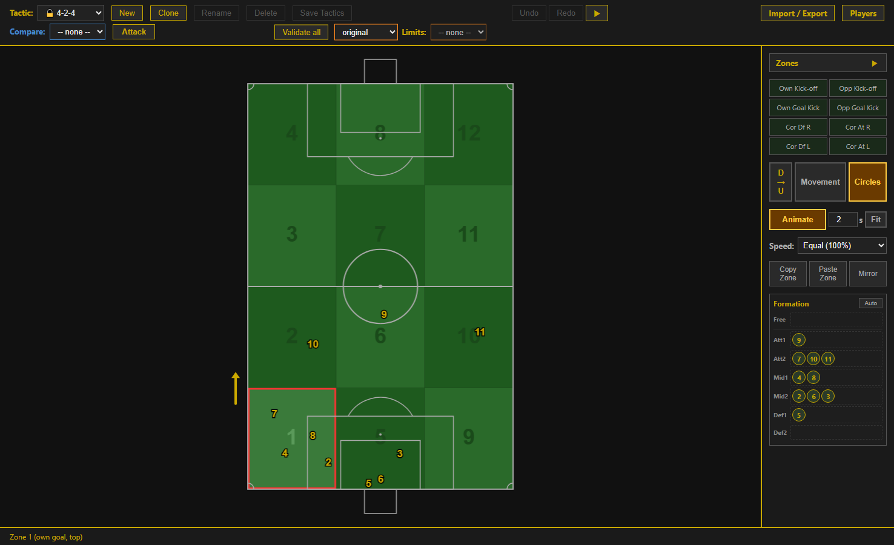
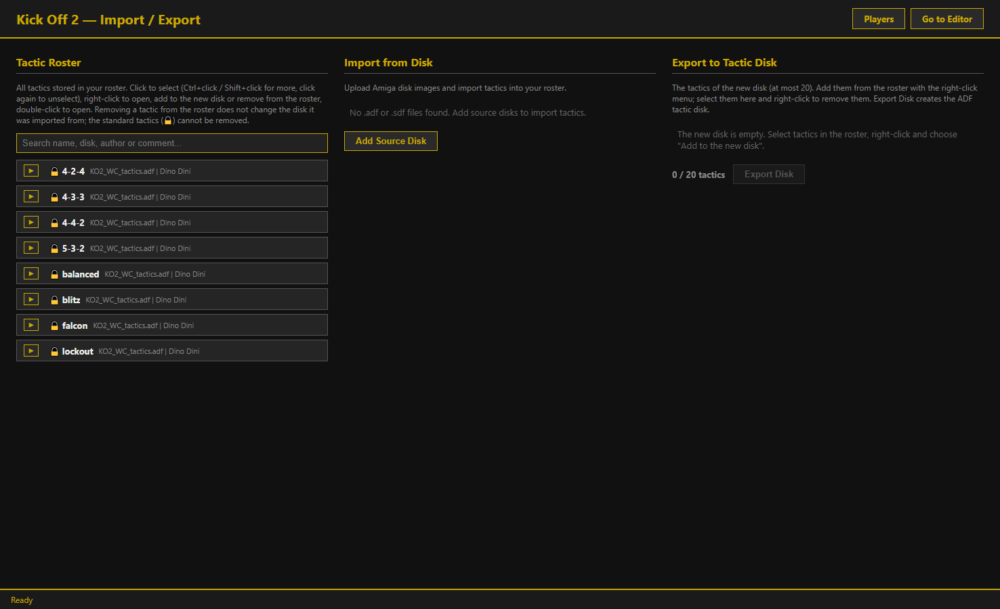

# Kick Off 2 Tactic Editor

A Windows editor for **Kick Off 2** tactics on the Amiga. Move the players on a pitch for each ball zone and special situation, then write your tactics to an Amiga disk image and use them in the game.

**[Download the latest version](https://github.com/4phycs/Release_KO2_Tactic_Editor/releases/latest)**

## Features

- **Edit tactics**: set the positions of the 10 outfield players in all 20 situations: 12 ball zones, kick-offs, goal kicks and corners.
- **Standard tactics**: the 8 standard tactics are included, ready to study or clone.
- **Limits**: keep a tactic within a chosen distance of a standard tactic. Areas outside the limits are greyed out, and **Validate all** lists any players outside them.
- **Compare and animate**: draw a second tactic over yours and watch the players move between situations.
- **Import and export**: import tactics from Amiga disk images (`.adf` / `.sdf`) and export up to 20 to a new tactic disk.
- **Players**: browse teams and skills from your own Kick Off 2 or Player Manager game disk, or from Player Manager saved careers.

## Getting started

1. Download `KO2TacticEditor-1.1-windows.zip` from the [latest release](https://github.com/4phycs/Release_KO2_Tactic_Editor/releases/latest).
2. Unzip the whole folder somewhere you can write, such as Documents or the Desktop. Your tactics are saved next to the exe.
3. Double-click `KO2TacticEditor.exe` and keep the black console window open while you work.
4. Open <http://localhost:5000> in your browser.

The exe isn't digitally signed, so Windows may show "Windows protected your PC". If so, click *More info*, then *Run anyway*. Some antivirus programs may also flag it.

See the [user guide](USER_GUIDE.md) for details and the [changelog](CHANGELOG.md) for what has changed.

## Game disks

No game disks are included. The editor and the 8 standard tactics work without one. The **Players** page and the **Speed** dropdown need your own game disk: copy it into the `Sources` folder or add it from the Import / Export page.

## Known issues

- The editor may occasionally stop at startup with a "port busy" error even though nothing else is using the port. Starting it again fixes this.
- Only one copy can run at a time, because the editor uses port 5000.

## Disclaimer

This is an unofficial fan project, not affiliated with or endorsed by the authors or rights holders of Kick Off 2 or Player Manager. Those games, their tactics and their data belong to their respective owners.

## License

MIT, see [LICENSE](LICENSE). It covers only the editor's own code, not Kick Off 2 or its data.

The Windows build also bundles third-party software under its own licences, listed in [THIRD_PARTY_NOTICES.txt](THIRD_PARTY_NOTICES.txt).

Made by Paolo Avogadro and Claude Code.
